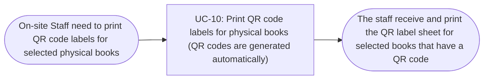

# Usage Flow: Group H Library Core System

<!--
DBIZ2 Lesson 8 template. File: docs/external-design/usage-flow.md
One map per actor and goal: the order in which an actor uses the system's use cases in real life
to reach one goal. An actor with one goal gets one flow; an actor who comes for clearly different
goals gets one flow per goal.
It is the bridge between Lesson 7 (one activity diagram = one use case) and the screens
(one actor moves through several use cases). Do not copy objectives, features or the architecture
here: they already live in W0, the Function List and your Lesson 4 architecture.
-->

| Field | Value |
|---|---|
| Product | Group H Library Core System |
| Version | v0.1 |
| Date | 2026-11-06 |
| Sources | W0 Table 1 (use case inventory); Use Case Diagram; Context Diagram; `AD-UC-10.md` |

## Before you draw: is Lesson 4 still true?

The supplied `AD-UC-10.md` identifies the inputs used for this flow: the Context Diagram, Use Case
Diagram, QR Code Label Printing sequence, W0 tables and W1 requirements. The supplied activity
diagram is version v1.1 (Draft). The `activity-index.md` Inputs check table was not included with
these files, so its overall status cannot be verified here.

The following UC-10 decisions are recorded in the activity diagram:

- Staff sign in with their internal library account (FR-04-07), not with UC-11, because UC-11 is the
  reader sign-in.
- Automatic QR generation starts when the daily catalogue sync finishes. The team decided to keep
  this time-triggered process in UC-10.
- Only physical books receive QR codes. Online-only books are excluded.

- [ ] Every row of the Inputs check table has Status "Done", or is logged as an open question.

## On-site Staff: print QR code labels for physical books

| Step | Use case | Activity diagram | Screens (fill in after Block 2) |
|---|---|---|---|
| 1 | UC-10 Print QR code labels for physical books (QR codes are generated automatically) | `AD-UC-10.md` | (Lesson 8) |

The staff flow is started by On-site Staff when they select physical books and choose Print labels.
Staff must have a valid internal library session and role; if they are not signed in, they sign in
with the internal library account and return to the book selection. UC-11 is not used because it
covers reader registration and sign-in, not staff sign-in.

## Use cases without a flow

No separate use case without a flow is identified in the supplied UC-10 inventory. However, UC-10
also contains a time-triggered process: after the daily catalogue sync finishes, the Library Core
System finds newly added books and generates a unique QR code for each new physical book that does
not yet have one. This process starts automatically, not through an On-site Staff action, and is
kept within UC-10 according to the decision recorded in `AD-UC-10.md`.
