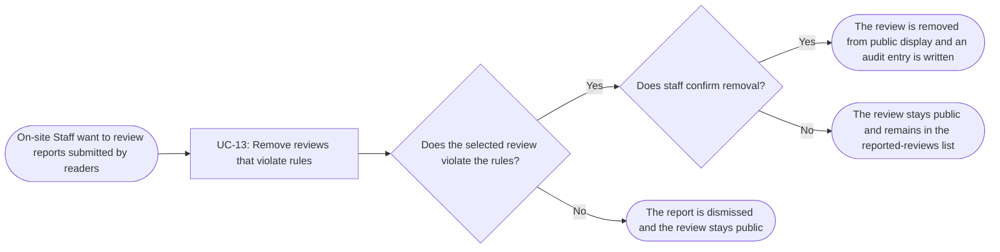

# Usage Flow: Group H Library Core System

<!--
DBIZ2 Lesson 8 template. File: docs/external-design/usage-flow.md
One map per actor and goal: the order in which an actor uses the system's use cases in real life
to reach one goal. An actor with one goal gets one flow; an actor who comes for clearly different
goals gets one flow per goal.
It is the bridge between Lesson 7 (one activity diagram = one use case) and the screens
(one actor moves through several use cases). Do not copy objectives, features or the architecture
here: they already live in W0, the Function List and your Lesson 4 architecture.
-->

| Field | Value |
|---|---|
| Product | Group H Library Core System |
| Version | v0.1 |
| Date | 2026-11-07 |
| Sources | W0 Table 1 (use case inventory); Use Case Diagram; `AD-UC-13.md`; `screen-list-UC13.md`; `docs/activity/activity-index.md` |

## Before you draw: is Lesson 4 still true?

The Inputs check table at the top of `activity-index.md` has 8 findings. Rows 1, 2, 6 and 8 are
"Done". Rows 3, 4, 5 and 7 are still "Open" and are logged as open questions:

- Row 3: a use case "Sync data from the library internal system" (started by time) is still to be added.
- Row 4: the sequences User Review Interaction Flow (UC-05 + UC-04) and Book Review API Interaction
  (UC-06 + UC-04) still tell two use cases and are to be split into one sequence per use case.
- Row 5: the sequence User Review Interaction Flow still uses `opt` / `alt` for the reader's choice to
  edit or delete a review; the choice is now a decision in AD-UC-04.
- Row 7: a step of the sequence User Review Reporting Flow cites FR-02-10 instead of FR-02-14.

These findings do not change the staff moderation flow below. It uses UC-13, which is started by
On-site Staff when they open the reported reviews.

- [ ] Every row of the Inputs check table has Status "Done", or is logged as an open question.

## On-site Staff: review reports and remove reviews that violate rules

| Step | Use case | Activity diagram | Screens |
|---|---|---|---|
| 1 | UC-13 Remove reviews that violate rules | `AD-UC-13.md` | S-F00-02, S-F02-04 |

The staff member uses the shared staff sign-in screen (`S-F00-02`) only when they do not have a
valid staff session and choose to sign in. After access is allowed, they open the Reported Reviews
screen (`S-F02-04`), select and inspect a reported review, and judge whether it violates the library's
review rules. If it violates the rules, staff choose Remove and confirm or cancel in the
"Confirm removal of reported review" modal. If confirmed, the system removes the review from public
display and writes an audit entry. If staff cancel, the review stays public and remains in the
reported-reviews list. If the review follows the rules, staff dismiss the report; the review stays
public and is removed from the reported-reviews list. Staff can then choose whether to handle another
reported review. The empty-list message is a state of `S-F02-04`, not a separate screen.

## Use cases without a flow

No use case in this flow is started by time or by an external system. UC-13 is started by On-site
Staff when they open the reported reviews. The reports themselves are submitted by Readers through
UC-14; handling those reports is the staff-initiated UC-13 flow above.
