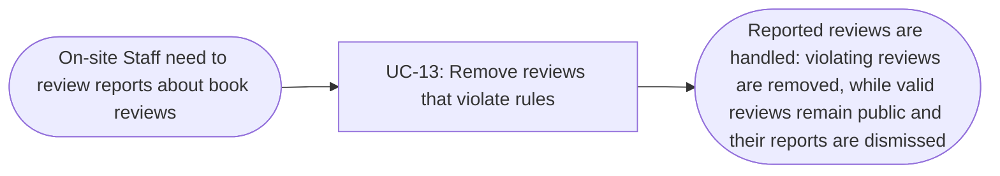

# Usage Flow: Group H Library Core System

<!--
DBIZ2 Lesson 8 template. File: docs/external-design/usage-flow.md
One map per actor and goal: the order in which an actor uses the system's use cases in real life
to reach one goal. An actor with one goal gets one flow; an actor who comes for clearly different
goals gets one flow per goal.
It is the bridge between Lesson 7 (one activity diagram = one use case) and the screens
(one actor moves through several use cases). Do not copy objectives, features or the architecture
here: they already live in W0, the Function List and your Lesson 4 architecture.
-->

| Field | Value |
|---|---|
| Product | Group H Library Core System |
| Version | v0.1 |
| Date | 2026-11-06 |
| Sources | W0 Table 1 (use case inventory); Use Case Diagram; Context Diagram; `AD-UC-13.md`; `screen-list-UC13.md` |

## Before you draw: is Lesson 4 still true?

The supplied `AD-UC-13.md` identifies the inputs used for this flow: the Context Diagram, Use Case
Diagram, User Review Reporting Flow sequence, W0 tables and W1 requirements. The supplied activity
diagram is version v1.2 (Draft). The `activity-index.md` Inputs check table was not included with
these files, so its overall status cannot be verified here.

The following UC-13 decisions and distinctions are recorded in the activity diagram:

- Staff sign in with their internal library account (FR-04-07), not with UC-11, because UC-11 is the
  reader sign-in.
- Staff judge whether a review violates the rules; the system does not judge review content.
- If a review violates the rules, staff choose Remove and confirm the removal. The system removes
  it from public display and writes an audit entry.
- If a review follows the rules, staff dismiss the report. The review stays public and leaves the
  reported-reviews list.
- UC-14 is the reader-side use case that creates the reports handled in this staff flow; it is a
  prerequisite/source of reported reviews, not a step in the staff's moderation flow.

- [ ] Every row of the Inputs check table has Status "Done", or is logged as an open question.

## On-site Staff: review reports and remove reviews that violate rules

| Step | Use case | Activity diagram | Screens (fill in after Block 2) |
|---|---|---|---|
| 1 | UC-13 Remove reviews that violate rules | `AD-UC-13.md` | S-F02-04, S-F00-02 |

The staff flow is started when On-site Staff open the reported reviews. Staff need a valid internal
library session and role; if they are not signed in, they can sign in with the internal library
account and return to the moderation page. If no reports are waiting, the system displays that
there are no reported reviews. Otherwise, staff review each report and decide whether the review
violates the rules. Removing a review requires confirmation; cancelling the confirmation leaves
the review public and in the reported list. Dismissing a report keeps the review public and removes
the report from the reported-reviews list.

## Use cases without a flow

No use case in this flow is started by time or by an external system. UC-13 is started by On-site
Staff. UC-14 is performed separately by a Reader to report a review that may violate the rules;
that reader action supplies the reported reviews but is not part of the staff's UC-13 usage flow.
