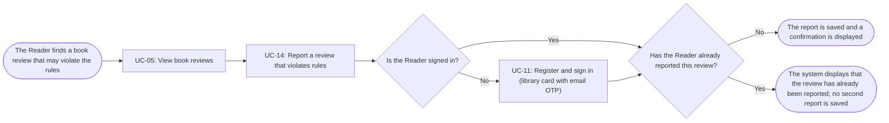

# Usage Flow: Group H Library Core System

<!--
DBIZ2 Lesson 8 template. File: docs/external-design/usage-flow.md
One map per actor and goal: the order in which an actor uses the system's use cases in real life
to reach one goal. An actor with one goal gets one flow; an actor who comes for clearly different
goals gets one flow per goal.
It is the bridge between Lesson 7 (one activity diagram = one use case) and the screens
(one actor moves through several use cases). Do not copy objectives, features or the architecture
here: they already live in W0, the Function List and your Lesson 4 architecture.
-->

| Field | Value |
|---|---|
| Product | Group H Library Core System |
| Version | v0.1 |
| Date | 2026-11-06 |
| Sources | W0 Table 1 (use case inventory); Use Case Diagram; Context Diagram; `AD-UC-14.md`; `usage-flow-UC04.md` |

## Before you draw: is Lesson 4 still true?

The supplied `AD-UC-14.md` identifies the inputs used for this flow: the Context Diagram, Use Case
Diagram, User Review Reporting Flow sequence, W0 tables and W1 requirements. The supplied activity
diagram is version v1.2 (Draft). The `activity-index.md` Inputs check table was not included with
these files, so its overall status cannot be verified here.

The following UC-14 decisions and distinctions are recorded in the activity diagram:

- Reporting a review is started by the Reader, usually from UC-05 (View book reviews).
- Reporting requires a signed-in Reader. If the Reader is not signed in, they can call UC-11
  (Register and sign in with library card and email OTP), then the system checks the session again.
- A Reader can report a particular review only once. A second report on the same review is rejected.
- Saving the report ends UC-14. The reported review stays public until On-site Staff handle it
  through UC-13; staff moderation is not part of this Reader flow.

- [ ] Every row of the Inputs check table has Status "Done", or is logged as an open question.

## Reader: report a review that violates rules

| Step | Use case | Activity diagram | Screens (fill in after Block 2) |
|---|---|---|---|
| 1 | UC-05 View book reviews (the Reader reaches the review from the book page) | `AD-UC-05.md` | S-F02-01 |
| 2 | UC-14 Report a review that violates rules | `AD-UC-14.md` | (Lesson 8) |
| 3 | UC-11 Register and sign in (library card with email OTP), only when the Reader is not signed in | `AD-UC-11.md` | S-F00-01 |

Step 3 is skipped when the Reader already has a valid session. If the Reader declines to sign in,
the request is denied and no report is saved. If the Reader has already reported the selected
review, the system displays a message and does not save a second report.

## Use cases without a flow

No use case in this flow is started by time or by an external system. UC-14 is started by the
Reader. UC-13 (Remove reviews that violate rules) is performed later by On-site Staff and is not
part of the Reader's reporting flow. The reported review remains publicly visible until staff
handle it through UC-13.
