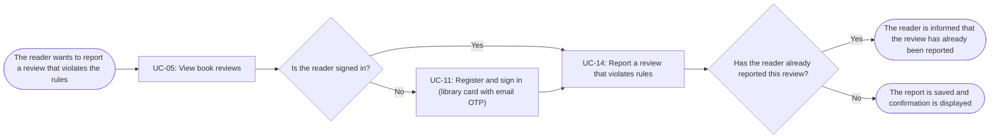

# Usage Flow: Group H Library Core System

<!--
DBIZ2 Lesson 8 template. File: docs/external-design/usage-flow.md
One map per actor and goal: the order in which an actor uses the system's use cases in real life
to reach one goal. An actor with one goal gets one flow; an actor who comes for clearly different
goals gets one flow per goal.
It is the bridge between Lesson 7 (one activity diagram = one use case) and the screens
(one actor moves through several use cases). Do not copy objectives, features or the architecture
here: they already live in W0, the Function List and your Lesson 4 architecture.
-->

| Field | Value |
|---|---|
| Product | Group H Library Core System |
| Version | v0.1 |
| Date | 2026-11-07 |
| Sources | W0 Table 1 (use case inventory); Use Case Diagram; `AD-UC-14.md`; `screen-list-UC14.md`; `docs/activity/activity-index.md` |

## Before you draw: is Lesson 4 still true?

The Inputs check table at the top of `activity-index.md` has 8 findings. Rows 1, 2, 6 and 8 are
"Done". Rows 3, 4, 5 and 7 are still "Open" and are logged as open questions:

- Row 3: a use case "Sync data from the library internal system" (started by time) is still to be added.
- Row 4: the sequences User Review Interaction Flow (UC-05 + UC-04) and Book Review API Interaction
  (UC-06 + UC-04) still tell two use cases and are to be split into one sequence per use case.
- Row 5: the sequence User Review Interaction Flow still uses `opt` / `alt` for the reader's choice to
  edit or delete a review; the choice is now a decision in AD-UC-04.
- Row 7: a step of the sequence User Review Reporting Flow cites FR-02-10 instead of FR-02-14.

These findings do not change the flow below. It uses UC-05 to reach the book reviews, then UC-14
to report a review. UC-14 ends when the report is saved and confirmed; staff handling is a separate
UC-13 flow.

- [ ] Every row of the Inputs check table has Status "Done", or is logged as an open question.

## Reader: report a review that violates rules

| Step | Use case | Activity diagram | Screens (fill in after Block 2) |
|---|---|---|---|
| 1 | UC-05 View book reviews (reached from the OPAC Book Detail) | `AD-UC-05.md` | S-F02-01 |
| 2 | UC-11 Register and sign in (library card with email OTP), only when the reader is not signed in | `AD-UC-11.md` | S-F00-01 |
| 3 | UC-14 Report a review that violates rules | `AD-UC-14.md` | S-F02-01 |

Step 2 is skipped when the reader already has a valid session. UC-14 is performed on the existing
Book Reviews screen (`S-F02-01`); it does not open a separate report screen. If the reader has
already reported the selected review, no second report is saved. If not, the report is saved and
a confirmation is displayed. The reported review remains public until staff handle it through UC-13.

## Use cases without a flow

No use case in this flow is started by time or by an external system. UC-14 is started by the Reader
when they select Report on a review, usually from UC-05. The later handling of the report is the
separate staff-initiated UC-13 flow.
