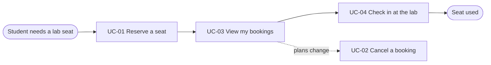
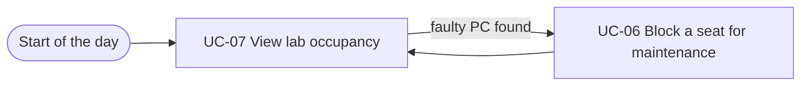

# Usage Flow: LabDesk (worked example)

> Worked example for teaching. Not a student submission and not a real product.

| Field | Value |
|---|---|
| Product | LabDesk |
| Version | v1.0 |
| Sources | W0 Table 1 (use case inventory); Use Case Diagram; `docs/activity/activity-index.md` |

## Before you draw: is Lesson 4 still true?

- [x] Every row of the Inputs check table in `docs/activity/activity-index.md` is "Done" or logged
      as an open question. Row 3 (a scheduler for timed jobs) was closed in the Lesson 4
      architecture with ADR-004; row 4 (split the "Booking flow" sequence) is still open and owned
      by Owner A.

## Student: get a seat and use it

| Step | Use case | Activity diagram | Screens |
|---|---|---|---|
| 1 | UC-01 Reserve a seat | `AD-UC-01.md` | S-F00-01, S-F01-01, S-F01-02 |
| 2 | UC-03 View my bookings | not needed | S-F01-03 |
| 3 | UC-04 Check in at the lab | `AD-UC-04.md` | S-F02-01 |
| (alt) | UC-02 Cancel a booking | `AD-UC-02.md` | S-F01-03 (modal "Cancel booking?") |

## Lab Technician: keep the labs usable

| Step | Use case | Activity diagram | Screens |
|---|---|---|---|
| 1 | UC-07 View lab occupancy | not needed | S-F00-01, S-F03-01 |
| 2 | UC-06 Block a seat for maintenance | `AD-UC-06.md` | S-F03-02 (modal "Block seat") |

Each actor of LabDesk comes for one goal, so each has one flow. A product like a library app,
where a reader comes either to find a book on the shelf or to write a review, would give that
actor one flow per goal.

## Use cases without a flow

| Use case | Started by | Described in |
|---|---|---|
| UC-05 Release no-show seats | Time (15 minutes after a slot starts) | `AD-UC-05.md`; the student only sees the result as an email |

## Checks before you save

- [x] Every actor that starts a use case has at least one flow.
- [x] An actor with clearly different goals has one flow per goal; no flow has more than about
      9 boxes (Student 4 use cases, Lab Technician 2).
- [x] Every actor name matches the Use Case Diagram and the Context Diagram.
- [x] Coverage: UC-01 to UC-04 (Must) and UC-06, UC-07 (Should) each appear in a flow with the
      same ID and name; UC-05 is listed under "Use cases without a flow"; no Won't-have use case
      appears.
- [x] No box is a click or a screen; no box tells two use cases.
- [x] Every flow renders on mermaid.live.
- [x] Every step has at least one screen, and every screen in `screen-list.md` appears in some step.
