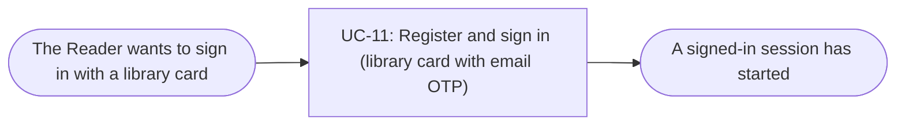

# Usage Flow: Group H Library Core System — UC-11

<!--
DBIZ2 Lesson 8 template. File: docs/external-design/usage-flow-UC11.md
One map per actor and goal: the order in which an actor uses the system's use cases in real life
to reach one goal. An actor with one goal gets one flow; an actor who comes for clearly different
goals gets one flow per goal.
It is the bridge between Lesson 7 (one activity diagram = one use case) and the screens
(one actor moves through several use cases). Do not copy objectives, features or the architecture
here: they already live in W0, the Function List and your Lesson 4 architecture.
-->

| Field | Value |
|---|---|
| Product | Group H Library Core System |
| Version | v0.2 — revised draft |
| Date | 2026-11-06 |
| Sources | W0 Table 1 (use case inventory); Use Case Diagram; `docs/activity/activity-index.md`; AD-UC-11 v1.3; `OPAC_Screen_Lists_UC01_UC02_UC11.md` |

## Before you draw: is Lesson 4 still true?

The Inputs check table at the top of `activity-index.md` has 8 findings. Rows 1, 2, 6 and 8 are
"Done". Rows 3, 4, 5 and 7 are still "Open" and are logged as open questions:

- Row 3: a use case "Sync data from the library internal system" (started by time) is still to be added.
- Row 4: the sequence Library Sign-In OTP Pipeline strictly details the authentication steps for UC-11.
- Row 5: OTP generation, 5-minute expiry, max 5 attempts, and resend loops are decision points inside AD-UC-11.
- Row 7: requirement mapping (FR-04-01, FR-04-04, FR-04-12, FR-04-16, FR-04-17) is kept consistent with W1.

None of them changes the flow below: it uses only use cases and the order in which the reader uses them.

- [ ] Every row of the Inputs check table has Status "Done", or is logged as an open question.

## Reader: Sign in with a library card

| Step | Use case | Activity diagram | Screens (fill in after Block 2) |
|---|---|---|---|
| 1 | UC-11 Register and sign in (library card with email OTP) | `AD-UC-11.md` | S-F00-01, S-F00-02 |

Step 1 is always used when the Reader initiates direct sign-in or is redirected from features requiring authentication (e.g., UC-04, UC-07, UC-08, UC-09, UC-12, UC-14).

## Use cases without a flow

No use case in this flow is started by time or by an external system. UC-11 is started by the Reader.

| Use case | Started by | Described in |
|---|---|---|
| — | — | — |

## Checks before you save

- [x] Every actor that starts a use case has at least one flow: Reader is covered for UC-11.
- [x] An actor with clearly different goals has one flow per goal; no flow has more than about 9 boxes.
- [x] Every actor name matches the Use Case Diagram and the Context Diagram (`Reader`).
- [x] Coverage: every in-scope use case of W0 Table 1 (Must, Should, Could) that a person starts appears in at least one flow, with the same ID and name.
- [x] No box is a click or a screen; no box tells two use cases.
- [x] Every flow renders on mermaid.live.
- [x] After Block 2: every step has at least one screen, and every screen in the screen list appears in some step (S-F00-01, S-F00-02).